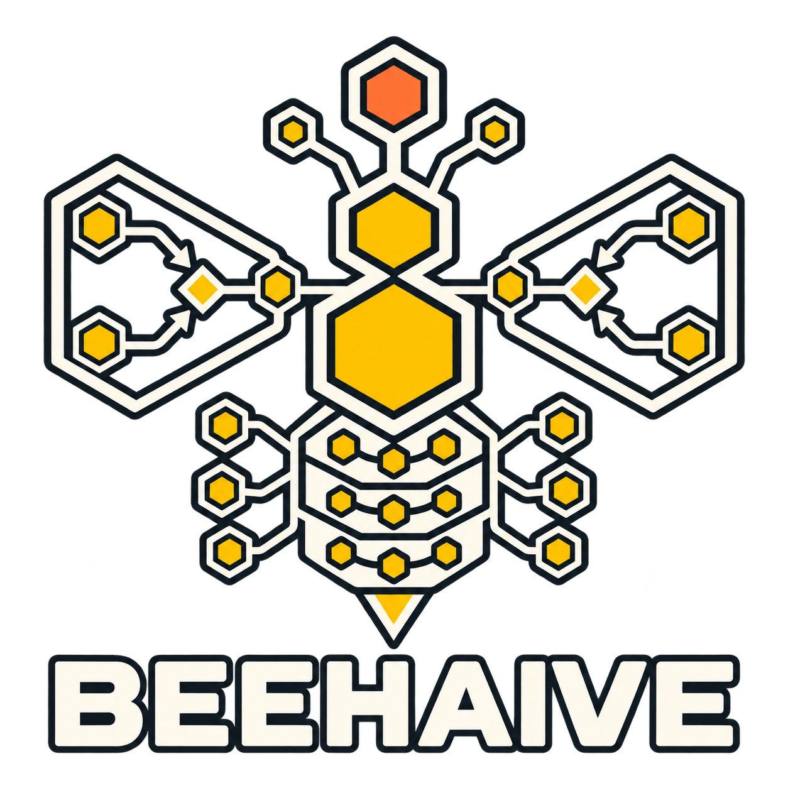

# BeeHAIve

<p align="center">
  
</p>

BeeHAIve is a local console for the agent work on this machine. It has two
pages:

- **The Archon console** (`/`) shows and drives the runs of a local
  [Archon](https://archon.diy) install: every run, what each one is waiting
  on, launching a workflow, and the trigger bindings and schedules that
  Archon's own web UI does not expose.
- **Claude Code sessions** (`/sessions`) is a read-only view of the Claude
  Code sessions you run from the desktop app or the CLI.

## The Archon console

It covers what Archon's own console does for runs, plus what Archon offers only
on the command line:

- **Runs**: every run across every project, filtered by status, project and
  text, updated live from Archon's event stream.
- **Run detail**: nodes, events, cost, artifacts, the run's result, and Cancel,
  Abandon or Resume. A paused run shows its question with the answer form or
  the gate's decisions.
- **Attention**: every run paused on a person, the same queue as
  `archon workflow attention --all`, answerable in place.
- **Pipeline**: for each repository a pbi queue binding serves, where every
  open issue stands: worked by a live run, waiting in a queue, waiting on your
  answer, or stuck, with the reason it is stuck. It also says whether each
  queue's trigger can start a run, calls a run stalled when its step has
  logged nothing for half an hour or run for three hours, and lists pull
  requests no issue owns. It runs `ledger.mjs` from archon-home's pbi
  workflows, which reads GitHub and takes about a minute, so the page keeps a
  reading for five minutes and reads again on Read again.
- **Launch**: pick a project and a workflow, fill its declared inputs, start it.
- **Projects**: the projects Archon knows, with links to launch or schedule.
- **Triggers**: the binding files in `~/.archon/triggers/` that
  `archon trigger fire` reads, a form that writes a new one (with presets for
  the SDLC pack's build queue, merge queue, discoveries and worktree cleanup),
  Fire now, the recent trigger receipts, and on Windows a Task Scheduler task
  per binding that fires it on its interval. Archon installs schedules itself
  only on macOS.

Chat, the workflow builder, settings, metrics and adding projects are still in
Archon's own console. The top bar links to it.

How it talks to Archon:

- `/archon/api/*` is passed through to Archon's server unchanged, event
  streams included, so the page needs only one origin.
- `/api/archon/*` is what BeeHAIve adds. Each route runs the Archon CLI or
  archon-home's `ledger.mjs` with a fixed argument list, or reads and writes
  binding files. A name from the browser is checked before it becomes a file
  name or an argument.
- Every request must name this machine in its Host header, and a request that
  changes something must carry the `X-BeeHAIve` header. Another website
  therefore cannot use your browser to start, answer or cancel a run.

Archon's server listens on all interfaces with no sign-in by default. BeeHAIve
does not change that. Set Archon's own bind address if other machines can
reach yours.

A page is a module in `beehaiive/web/console/views/` listed in
`console/main.js`. It exports `{ id, title, nav, match, mount }`; `mount` gets
the API client and the live feed, and returns a cleanup function. Rules that
need no DOM go in `console/model.js`, which `node --test` covers.

## Claude Code sessions

The left column lists the sessions that are working now, each with the request
or stage it is on, how long that has run, and one line per live subagent saying
what it is doing. Below them is a short list of recent sessions.

Selecting a session shows what it did at the level you would describe it, not
tool call by tool call:

- A session that runs dod-guard's `/goal-sdlc` is shown as one row per issue,
  with one chip per stage run (refine, next-ticket, draft PR, review, fix
  review, complete). Each chip shows how long the stage took and whether it
  finished, stopped, went quiet or failed. The session links to its GitHub
  repository, its open GitHub Projects and the pull requests it touched.
- Any other session is shown as its turns: what you asked, how long Claude
  worked on it, the first sentence of its answer, and the subagents it started.
- "Needs attention" lists only what a person has to act on: a stage that
  stopped, failed or went quiet and that no later stage for the same issue
  took over. Hook blocks, tool errors Claude recovered from and API retries
  are only counted.

Clicking a stage or subagent opens its result, its stop reason, its own
subagents and, folded away, every tool call it made.

This page never starts, stops or steers a Claude Code session, and never
writes to git or GitHub. It only reads what Claude Code writes to disk.

## Setup

Use Python 3.13 and `uv`. A local Archon install is needed for the console;
without one its pages say Archon did not answer. The GitHub CLI (`gh`), signed
in, is optional. For a goal-sdlc session it reads, over the REST API every five
minutes, which issues and pull requests are still open and which of the
owner's open Projects is named after the repository.

```powershell
git clone https://github.com/TychoHenzen/BeeHAIve.git
Set-Location BeeHAIve
uv sync
.\start_dashboard.bat
```

Open `http://127.0.0.1:8000/`. `uv run python -m beehaiive` starts the same
server without the launcher. The launcher refuses a port that is already in
use and stops the server process tree when it exits.

Every setting is optional. Put any of them in `.env` (see `.env.example`) or in
the environment, which wins over `.env`:

- `BEEHAIIVE_CLAUDE_PROJECTS`: the transcript folder, by default
  `~/.claude/projects`.
- `BEEHAIIVE_LOOKBACK_HOURS`: how far back to show sessions, by default 24.
- `BEEHAIIVE_PORT`: by default 8000.
- `BEEHAIIVE_ARCHON_HOME`: Archon's home folder. By default `ARCHON_HOME`,
  then `~/.archon`.
- `BEEHAIIVE_ARCHON_URL`: Archon's server. By default
  `http://127.0.0.1:<port>`, with the port from `server.json` in Archon's
  home, or 3090.
- `BEEHAIIVE_ARCHON_BIN`: the `archon` program. By default the `binary` named
  in `install.json` in Archon's home.

Scheduled tasks run `archon` with its default home, so keep the default home
if you schedule bindings; the Triggers page warns when it is not.

## How the sessions page works

Claude Code writes each session to
`~/.claude/projects/<project>/<session-id>.jsonl`, and each subagent to a
`subagents/agent-<id>.jsonl` file beside it with a `.meta.json` file that
names the tool call that launched it. A background thread reads only the bytes
added since its last pass, every two seconds, and skips record types the
dashboard does not use. The first pass over a day of heavy use takes some
seconds; the page says so while it runs.

A thread counts as working when it wrote something in the last two minutes,
when a tool call it started less than fifteen minutes ago has not returned, or
when one of its subagents is working. A subagent that stopped without its
launch call returning is shown as stalled ("went quiet"). A stage counts as
stopped when its last message gives a "Stop reason".

The transcript format is internal to Claude Code and undocumented. Every field
is read defensively, so a format change shows up as missing detail or as a
count of records that could not be read, not as a crash. Codex sessions are
not read.

## Local gate

```powershell
uv run ruff format --check .
uv run ruff check .
uv run pyright
uv run pytest -q --cov=beehaiive --cov-report=term-missing --cov-fail-under=90
node --test tests/*.test.mjs
uv run pip-audit --progress-spinner off
```
