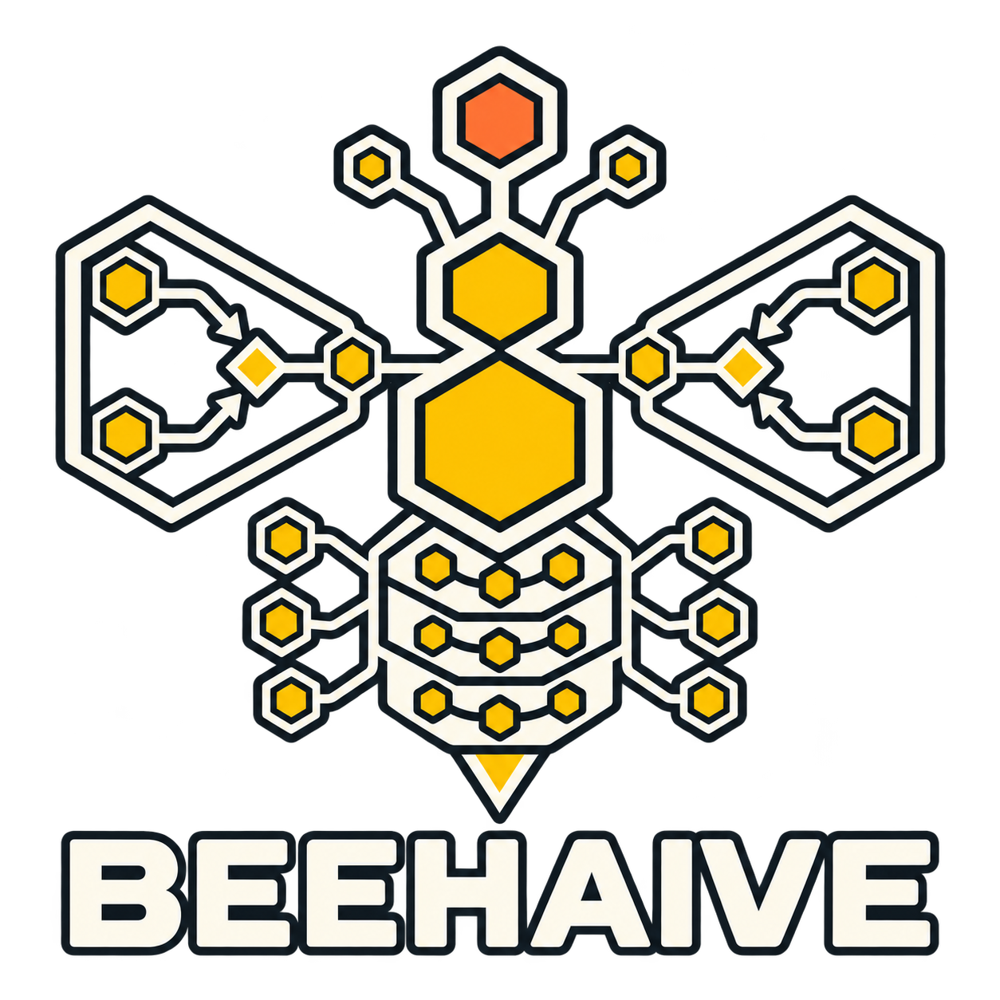

# BeeHAIve

<p align="center">
  
</p>

BeeHAIve is a local, read-only dashboard for the Claude Code sessions you run
from the desktop app or the CLI. The left column lists the sessions that are
working now, each with the request or stage it is on, how long that has run,
and one line per live subagent saying what it is doing. Below them is a short
list of recent sessions.

Selecting a session shows what it did at the level you would describe it, not
tool call by tool call:

- A session that runs dod-guard's `/goal-sdlc` is shown as one row per issue,
  with one chip per stage run (refine, next-ticket, draft PR, review, fix
  review, complete). Each chip shows how long the stage took and whether it
  finished, stopped, went quiet or failed. The session links to its GitHub
  repository, its open GitHub Projects and the pull requests it touched.
- Any other session is shown as its turns: what you asked, how long Claude
  worked on it, the first sentence of its answer, and the subagents it started.
- "Needs attention" lists only what a person has to act on: a stage that
  stopped, failed or went quiet and that no later stage for the same issue
  took over. Hook blocks, tool errors Claude recovered from and API retries
  are only counted.

Clicking a stage or subagent opens its result, its stop reason, its own
subagents and, folded away, every tool call it made.

BeeHAIve never starts, stops or steers an agent, and never writes to git or
GitHub. You keep working in Claude Code; BeeHAIve only reads what Claude Code
writes to disk.

## Setup

Use Python 3.13 and `uv`. The GitHub CLI (`gh`), signed in, is optional: it is
only used to find the Projects linked to a goal-sdlc session's repository.

```powershell
git clone https://github.com/TychoHenzen/BeeHAIve.git
Set-Location BeeHAIve
uv sync
.\start_dashboard.bat
```

Open `http://127.0.0.1:8000/`. `uv run python -m beehaiive` starts the same
server without the launcher. The launcher refuses a port that is already in
use and stops the server process tree when it exits.

Every setting is optional. Put any of them in `.env` (see `.env.example`) or in
the environment, which wins over `.env`:

- `BEEHAIIVE_CLAUDE_PROJECTS`: the transcript folder, by default
  `~/.claude/projects`.
- `BEEHAIIVE_LOOKBACK_HOURS`: how far back to show sessions, by default 24.
- `BEEHAIIVE_PORT`: by default 8000.

## How it works

Claude Code writes each session to
`~/.claude/projects/<project>/<session-id>.jsonl`, and each subagent to a
`subagents/agent-<id>.jsonl` file beside it with a `.meta.json` file that
names the tool call that launched it. A background thread reads only the bytes
added since its last pass, every two seconds, and skips record types the
dashboard does not use. The first pass over a day of heavy use takes some
seconds; the page says so while it runs.

A thread counts as working when it wrote something in the last two minutes,
when a tool call it started less than fifteen minutes ago has not returned, or
when one of its subagents is working. A subagent that stopped without its
launch call returning is shown as stalled ("went quiet"). A stage counts as
stopped when its last message gives a "Stop reason".

The transcript format is internal to Claude Code and undocumented. Every field
is read defensively, so a format change shows up as missing detail or as a
count of records that could not be read, not as a crash. Codex sessions are
not read.

## Local gate

```powershell
uv run ruff format --check .
uv run ruff check .
uv run pyright
uv run pytest -q --cov=beehaiive --cov-report=term-missing --cov-fail-under=90
node --test tests/*.test.mjs
uv run pip-audit --progress-spinner off
```
